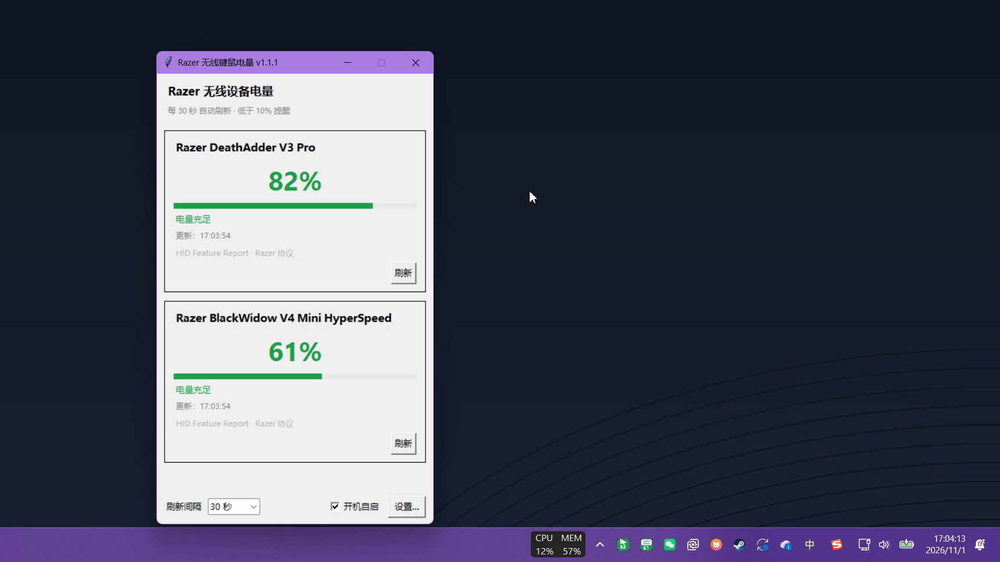
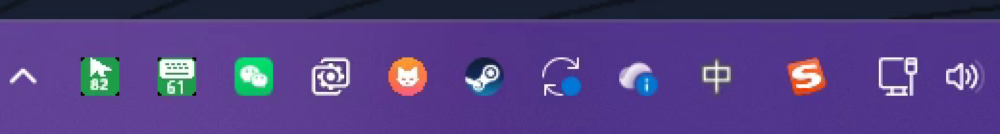

# Razer 无线键鼠电量托盘

Windows 10/11 下读取 Razer 无线键鼠电量的小工具：**纯 Python 标准库 + ctypes，无第三方依赖、无管理员权限、不写注册表、不写日志**。

当前版本 **v1.1.1**：重点解决「键盘待机读到假 0%、低电量弹窗反复骚扰」的问题，并让托盘图标同时显示设备类型（鼠标/键盘图形）和电量数字。



## 特性

- **托盘直接看电量**：光标 = 鼠标、键盘图形 = 键盘，图形下方是精确电量；底色表示等级
  （绿 60+ / 琥珀 30-59 / 橙 10-29 / 红 1-9），待机/旧数据会压暗。
- **待机 0% 不再误报**：0% 视为无效读数，保留上一次有效电量，不弹假警报。
- **低电量弹窗**：右下角卡片，15 秒自动关闭（可设置），不抢焦点；连续确认 + 回差 + 冷却避免反复打扰。
- **上次电量持久化**：冷启动时键盘还在待机，也能显示「61%（设备待机，5 分钟前）」。
- **设置界面**：阈值、确认次数、弹窗时长、冷却、图标样式、开机自启只显示托盘。
- **单实例**：再次双击不会起第二个进程，而是唤起已运行实例的面板。
- **托盘菜单**：电量摘要 / 打开面板 / 立即刷新 / 暂停自动刷新 / 低电量提醒开关 / 设置 / 退出。

托盘图标（3 倍放大）：



## 运行

需要 Python **3.10+**（使用了 `int | None` 类型标注），无需安装任何 pip 包。

```
python main.py                 # 简洁面板 + 托盘常驻
python main.py --minimized     # 只显示托盘图标（开机自启用这个）
python main.py --debug         # 附加调试界面（HID 枚举 / 报告探测 / 协议标定）
python main.py --no-tray       # 不显示托盘（仅面板，关闭即退出）
python main.py --demo         # 演示模式：假数据，截图/录屏用（不读写配置）
python main.py --smoke 10      # 冒烟测试：10 秒后自动退出
```

双击 `run.bat` 会用 `pythonw.exe` 无控制台启动。

## 形态

### 简洁面板

两款设备卡片：设备名、大号电量、进度条、状态、更新时间、来源、手动刷新。
电量分色：绿 60-100 / 琥珀 30-59 / 橙 10-29 / 红 1-9 / 灰未知。
底部：刷新间隔、开机自启、设置入口。

### 托盘

- **默认图标 = 设备图形 + 电量数字**：鼠标是光标箭头、键盘是键盘图形，图形下方是精确电量；
  图标底色表示电量等级。
- 设备待机或数据过期时图标会**压暗**，提示「这是上次读数」；从未读到过则显示灰色 `?`。
- 悬停 tooltip：设备名 + 电量 + 更新时间 + 状态（待机 / 无响应 / 上次读数）。
- **左键**打开面板，**中键**立即刷新，**右键**菜单。
- 设置里可以把图标样式换成「仅电量数字」（数字更大，但两台设备需要靠 tooltip 区分）。

### 低电量弹窗

- 右下角无边框卡片，**15 秒后自动关闭**（可设置，0 = 不自动关）；倒计时实时显示。
- 不抢焦点（`SetWindowPos(SWP_NOACTIVATE)`），可以「打开面板」或「知道了」。
- 两台设备同时告急时向上堆叠，最多 3 条。

### 设置

低电量阈值、连续确认次数、弹窗停留秒数、重复提醒冷却、忽略 0%（待机保护）、
提醒总开关、托盘图标样式、开机自启时只显示托盘。

## 防误报机制（重点）

无线键盘会自动待机省电，此时读取可能「成功」但返回 0，或干脆超时。直接显示/提醒会反复弹假 0。
本工具的处理链路：

1. **0% 视为无效读数**（可关闭）：不显示、不提醒、不写入状态；保留上一次有效电量。
2. **状态区分**：`正常` / `设备待机`（读到 0%）/ `读取无响应`（超时）/ `上次读数`（冷启动缓存）/ `未连接`，
   旧数据都会明确标注时间与「几分钟前」。
3. **连续确认**：必须连续 N 次（默认 2 次）读到 `0 < 电量 < 阈值` 才提醒，单次抽风不打扰。
4. **回差**：提醒后只有电量回升到 `阈值 + 5%` 以上才重新武装，避免在 10% 附近反复弹。
5. **冷却**：默认 60 分钟内不重复提醒。
6. **0% 永远不提醒**：阈值判断只在 `> 0` 且 `< 阈值` 时成立，符合「0 不提示，只提示小于 10」。
7. **上次有效值持久化**（`state.json`）：冷启动时键盘还在待机，也能显示「61%（设备待机，5 分钟前）」
   而不是 `--`/`?`；该值只用于展示，绝不参与提醒。

## 演示模式

`--demo` 不接触真实 HID 设备，按时间线产生可预期的读数（0.6s 鼠标 82%/键盘 61%，20s 键盘待机读到 0%，
34s 鼠标 9% 触发弹窗），并且不读写 `config.json` / `state.json`，适合截图和录屏。

录屏时可用环境变量调整后两个时间点（秒）：

```
set RAZER_DEMO_TIMELINE=30,42.5
python main.py --demo
```

## 文件

- `config.json`：用户设置（缺失或非法值会自动回落默认值；支持带 BOM 的 UTF-8）。
- `state.json`：上次有效电量缓存（自动生成，删除无副作用）。
- 不写任何日志文件。

## 关键机制

- 后台工作线程做 HID 通信，`queue.Queue` 结果泵，主线程 `root.after` 取结果；同一设备并发请求合并。
- 单实例 = 命名互斥量；再次启动通过命名事件唤起已有实例的面板。
- 开机自启 = 启动文件夹 `电量托盘.lnk`（COM IShellLink，目标 `pythonw.exe`，参数 `main.py --minimized`），
  不写注册表 Run；启动时若快捷方式存在会自动校正到当前目录。
- **不在桌面创建任何链接/快捷方式/启动脚本**。
- 托盘定时器通过 `PostMessage` 切回托盘线程设置 `SetTimer`，避免跨线程 `SetTimer` 不生效。
- 关闭面板隐藏到托盘；退出幂等清理图标 / 定时器 / 线程 / 窗口。

## 电池读取协议（已实机验证）

Razer 无线设备：带 Feature Report 的接口（如 `MI_00`，91 字节）承载电池交易。

- 请求 = `[0x00] + [status=00, txid, 00,00,00, class=02, id=07, 0x80] + 80×00 + [XOR校验, 00]`
- XOR 校验 = 头 `[txid..0x80]` 逐字节异或
- 响应在 `status=0x02` 且 txid 匹配时，`[10]` 为电池原始值 0–255，`round(raw/255*100)` 为百分比

**多设备共用接收器**：鼠标（`1532:00B7`）和键盘（`1532:02B9`）共用一个 HyperSpeed
接收器时，两者复合在鼠标 PID `00B7` 下，只暴露一个 `MI_00` 电池接口，靠 **txid 高位
0x80 寻址**：

- 鼠标：txid `0x1F` → 读鼠标电量
- 键盘：txid `0x9F` → 读键盘电量

**注意**：Razer Synapse 运行时会独占该接口的 READ 通道（`GENERIC_READ` 被拒），但 `GENERIC_WRITE`
句柄仍能 `HidD_GetFeature` 读回，且并发交易会污染响应——读取时按 txid 过滤即可。

键盘单独用自己接收器时 PID 为 `02B9`，此时走自己的接口；共享接收器时如上走鼠标的 `MI_00`。

## 已知限制

- 真·0% 与「待机假 0」无法从协议上区分，因此统一按无效处理；正常使用中低于 10% 时就会提前提醒。
- 设备待机时无法主动唤醒读取，只能等下一次刷新或用户操作设备。
- 目前只内置 DeathAdder V3 Pro 与 BlackWidow V4 Mini HyperSpeed 两款设备；
  新设备可在 `razerbattery/devices.py` 里加一条 `DeviceModel`（txid 需要探测）。

## License

[MIT](LICENSE)
